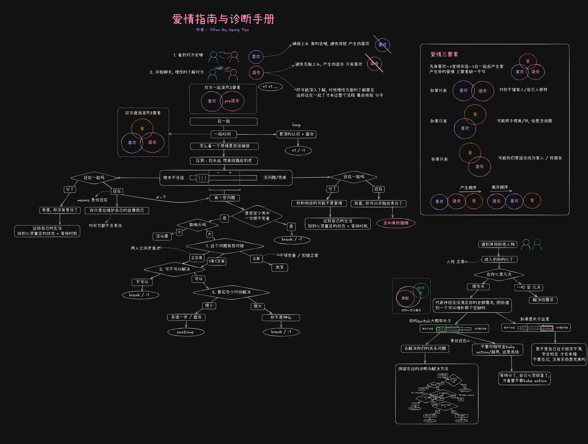

# OpenLove

**一起探索爱情，分享思考，让好的关系观念不断进化。**

OpenLove 是 **Love Lab** 发起的开放协作项目。我们希望把关于爱情与亲密关系的想法，逐步整理成清晰、易理解、可讨论的**原则、逻辑图和问题诊断手册**，帮助大家从不同角度理解关系、分析问题、寻找可能的解决方式。

这里没有一套适用于所有人的「标准爱情答案」。我们更希望大家一起提出问题、质疑观点、补充经验，让这份手册随着讨论不断完善。

## 💗 项目缘起

**2026 年 10 月**，Henry Teo 和几位朋友聚在一起，聊到了各自对爱情与亲密关系的困惑、经历和看法。讨论中，我们开始思考：

- 「喜欢」「适合」和「爱」有什么不同？
- 一段关系是怎样开始、发展和变化的？
- 发生矛盾时，应该怎么判断和处理？
- 有没有办法把零散的想法整理成一套更容易理解、可以持续改进的思考框架？

于是，我们把这些讨论画成了第一版《爱情指南与诊断手册》，也有了 **OpenLove**。

## 🧩 当前版本：V1 思路图

V1 是整个项目的起点，记录了最初的爱情三要素、关系发展路径，以及面对关系问题时的一些判断与处理思路。

> **V1 只是初步的思考骨架，并非经过科学验证的统一结论。** 我们欢迎不同观点，也会不断修订其中不够准确、过于绝对或尚未考虑周全的部分。

### V1 创作与贡献

- **何一帆（Yifan Ho）**：提出最初的哲学思考骨架，包括爱情三要素、爱情的形成及相关基础原则。
- **Henry Teo**：在原始想法上进一步扩展、梳理逻辑、建立判断流程，并绘制与完善 V1 思路图。
- **参与讨论的朋友们**：提供问题、观点与交流，促成了项目的诞生。

## 🚀 接下来想做什么

- **图谱数字化**：将目前的静态思路图逐步转换成更容易阅读、检索、维护和更新的结构化 Graph。
- **完善开放手册**：持续补充爱情与亲密关系的原则、典型问题、分析路径及可供参考的解决方法。
- **多语言支持**：让来自不同语言背景的人都能阅读、讨论和贡献内容。
- **社区共同维护**：通过 GitHub Issues、Pull Requests 和讨论，不断提出新观点、修正问题、更新版本。
- **LoveOS（规划中）**：探索基于 OpenLove 框架的 AI 对话助手，帮助用户整理关系问题、思考不同选择，而不是替用户做决定。
- **LoveCards（构想中）**：尝试将这些观点设计成反思卡牌、情境游戏或桌游，让讨论爱情变得更有趣。

这些都是目前的方向，不代表已经完成。我们会从完善这份手册开始，一步一步推进。

## 🤝 欢迎一起贡献

**爱情没有唯一的标准答案，这个项目也不应该只由少数人来定义。**

如果你有新的观点、发现了逻辑漏洞，或经历过值得讨论的关系问题，欢迎：

1. 提交 **Issue**，分享问题、建议或不同意见。
2. 提交 **Pull Request**，完善文字、流程图、案例或翻译。
3. 参与讨论，以尊重、开放的态度共同改进这份手册。

我们欢迎质疑与分歧，也重视隐私：分享真实经历时，请避免公开他人的个人信息。

## 📌 一个小提醒

OpenLove 提供的是**思考工具和交流框架**，不是心理治疗、专业咨询，也不能保证诊断或预测任何一段关系的未来。每个人与每段关系都不同；请把这里的内容当作参考，而不是绝对规则。

---

**Made with love, curiosity, and a lot of conversations.**

*Love Lab · OpenLove · Started in October 2026*
